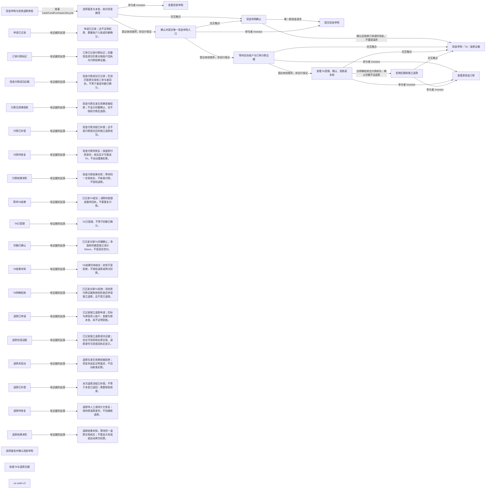

# 现金申购体验与证据反馈

> 派生设计提议，不是运行结果。修改来源便签，不手改此文件。

## 来源

- `ux.cash-v2`：`tree/inbox/storyMapping/relation-sm-cash-purchase-v2-experience-proposal-0.yaml/payload/info/artifact`

## 反馈状态（历史观测须按关联和水位合并，不直接覆盖终态）

| 状态 | 事件证据 | 文案 |
|---|---|---|
| 申请已记录 | FundOrder.FundPurchaseSettlementRequested | 申请已记录；这不证明扣款、募集账户入账或份额确认。 |
| 订单付款标记 | FundOrder.FundSubscriptionPaymentConfirmed | 订单已记录付款标记；完整现金成功仍需关联账户回执与付款结果证据。 |
| 现金付款成功证据 | FundOrder.FundCashPaymentSucceeded | 现金付款成功已记录；仍须匹配原交易和三参与者回执，不等于基金份额已确认。 |
| 付款无效果拒绝 | FundOrder.FundCashPaymentRejectedBeforeEffects | 现金付款在发生效果前被拒绝；不显示份额确认，也不授权付款后退款。 |
| 付款已补偿 | FundOrder.FundCashPaymentCompensated | 现金付款流程已补偿；这不是付款提交后的独立退款成功。 |
| 付款待恢复 | FundOrder.FundCashPaymentRecoveryRequired | 现金付款待恢复；保留原付款身份，核实后才可推进TA，不自动重新扣款。 |
| 付款结果未知 | FundOrder.FundCashPaymentOutcomeUnknown | 现金付款结果未知；等待同一交易核实，不新发付款，不授权退款。 |
| 等待TA结果 | FundOrder.FundTASubmissionRegistered | 已记录TA提交；请等待受理或最终回执，不要重复付款。 |
| TA已受理 | FundOrder.FundTAAccepted | TA已受理，不等于份额已确认。 |
| 份额已确认 | FundOrder.FundTASharesConfirmed | 已记录关联TA份额确认；净值和份额是独立演示fixture，不是真实定价。 |
| TA结果未知 | FundOrder.FundTAOutcomeUnknownObserved | TA结果仍待核实；未知不是拒绝，不授权退款或再次扣款。 |
| TA明确拒绝 | FundOrder.FundTARejected | 已记录关联TA拒绝；须经原付款证据和授权检查后申请独立退款，这不是已退款。 |
| 退款已申请 | FundOrder.FundPurchaseRefundRequested | 已记录独立退款申请；目标为原投资人账户，金额为原本金，尚不证明到账。 |
| 退款完成证据 | FundOrder.FundRefundCompleted | 已记录独立退款成功证据；仅在可信桥核实原交易、退款身份与现金回执后显示。 |
| 退款未启动 | FundOrder.FundPurchaseRefundRejected | 退款在发生效果前被拒绝；资金未由此证明返还，不自动新发扣款。 |
| 退款已补偿 | FundOrder.FundPurchaseRefundCompensated | 本次退款流程已补偿，不等于本金已退回；需要授权核查。 |
| 退款待恢复 | FundOrder.FundPurchaseRefundRecoveryRequired | 退款待人工或持久化恢复；保持原退款身份，不创建新退款。 |
| 退款结果未知 | FundOrder.FundPurchaseRefundOutcomeUnknownObserved | 退款结果未知，等待同一退款交易核实；不要显示完成或自动再次扣款。 |

## 反馈与无障碍约束

- 付款结果是独立维度：订单PAYMENT_SETTLED标记不单独证明完整付款成功；显示结果须经关联付款桥认证。
- TA未知是观测：恢复到确认/拒绝后，旧unknown记录不覆盖新终态；退款unknown同理。
- 不同身份的TA受理与确认分别展示；同身份同正文去重，同身份异正文显示冲突并停止自动推进。
- 仅TA_REJECTED + 成功付款与原请求证据授权独立退款；无投资者按钮接受自选退款金额/收款人。
- 源码声明不是自动运行；payment/TA/refund trusted bridges and read-model chronology remain pending。
- 状态使用文字与图标，不只靠颜色
- 清晰键盘焦点与逻辑阅读顺序
- 异步变化不抢焦点，礼貌播报等待/未知
- 金额币种、演示fixture与最后核实时间显式展示
- 传输错误保留请求身份，无自动重发金融操作
