# cash-v2：现金付款、TA观测与独立退款

> 派生设计提议，不是运行结果。修改来源便签，不手改此文件。

```mermaid
flowchart LR
  n_5aff1bd79b21e785["现金申购申请已记录"]
  n_dc2634ffb84a6e7b["投资人账户：预留／扣款"]
  n_43228e7dac1d4d77["募集账户：incoming登记／入账"]
  n_8796f1ebbe2a9a81["订单TCC：最后commit"]
  n_a1691aaa321f069b["现金付款成功已记录"]
  n_4f2d2477f0f16cea["现金付款无效果拒绝"]
  n_81b9b6397c1fd967["现金付款已补偿，非支付后退款"]
  n_81f5e7b8a45707ab["现金付款待恢复，同一身份"]
  n_63bad3cac4704b10["现金付款未知，不授权新扣款/退款"]
  n_106b1eb749c1db32["可信桥核实同一付款成功与三参与者证据"]
  n_0753dc9935f00c8f["已记录TA提交"]
  n_4f797e1b264f5ead["TA受理不是份额确认"]
  n_d4e3f9ab9be82aa1["关联份额已确认"]
  n_093672592562c4f0["TA未知：观测，不授权退款"]
  n_0cc7497c97714c61["TA明确拒绝"]
  n_7a86b846105efcfd["付款成功＋关联拒绝＋原本金／账户授权"]
  n_da65717a726eb4d2["独立退款申请，不是到账"]
  n_2dcc001b955b6397["募集账户：新交易预留／扣款"]
  n_f63d2411f66d2c2c["原投资人账户：新incoming／入账"]
  n_0fe0a170c383f939["可信桥核实独立退款终态"]
  n_7bbacb05258e3a20["退款成功证据已记录"]
  n_5c50d65e324b877c["退款无效果拒绝：非退款成功"]
  n_9ef36b252bd80527["退款已补偿：非本金到账"]
  n_1a3d7b353fcc9a5b["退款待恢复：同一身份核实"]
  n_f3c504d8aae773ab["退款未知：同一身份核实"]
  n_8e14b46216f6ad9a["flow.cash-v2"]
  n_5aff1bd79b21e785 -->|"payment-v2：三singleton Prepare barriers与durable decision"| n_dc2634ffb84a6e7b
  n_dc2634ffb84a6e7b -->|"Commit序1→2；资金实际收款方"| n_43228e7dac1d4d77
  n_43228e7dac1d4d77 -->|"Commit序2→3"| n_8796f1ebbe2a9a81
  n_5aff1bd79b21e785 -->|"订单Prepare/Commit前可能无效果拒绝；须可信start关联"| n_4f2d2477f0f16cea
  n_5aff1bd79b21e785 -->|"付款提交前补偿；非独立退款"| n_81b9b6397c1fd967
  n_5aff1bd79b21e785 -->|"等待同一付款持久化核实"| n_81f5e7b8a45707ab
  n_5aff1bd79b21e785 -->|"未知观测；不换身份"| n_63bad3cac4704b10
  n_8796f1ebbe2a9a81 -->|"关联账户/订单精确回执后可信结果发布"| n_a1691aaa321f069b
  n_81f5e7b8a45707ab -->|"认证同身份reconciliation；并核实成功回执"| n_a1691aaa321f069b
  n_63bad3cac4704b10 -->|"认证同身份reconciliation；并核实成功回执"| n_a1691aaa321f069b
  n_a1691aaa321f069b -->|"专用terminal账本与实际三方回执共同核实"| n_106b1eb749c1db32
  n_8796f1ebbe2a9a81 -->|"订单标记不是完整现金成功"| n_106b1eb749c1db32
  n_106b1eb749c1db32 -->|"成功证据后，可信桥尚未实现"| n_0753dc9935f00c8f
  n_0753dc9935f00c8f -->|"独立受理回执"| n_4f797e1b264f5ead
  n_4f797e1b264f5ead -->|"不同receiptId的最终确认"| n_d4e3f9ab9be82aa1
  n_0753dc9935f00c8f -->|"观测可发生，保持先前生命周期"| n_093672592562c4f0
  n_093672592562c4f0 -->|"后续核实，不用unknown覆盖终态"| n_d4e3f9ab9be82aa1
  n_0753dc9935f00c8f -->|"明确关联拒绝"| n_0cc7497c97714c61
  n_4f797e1b264f5ead -->|"不同receiptId的最终拒绝"| n_0cc7497c97714c61
  n_093672592562c4f0 -->|"后续核实才产生拒绝事实"| n_0cc7497c97714c61
  n_0cc7497c97714c61 -->|"非所有异常；只明确拒绝"| n_7a86b846105efcfd
  n_7a86b846105efcfd -->|"原账户／原本金，新operation/txid"| n_da65717a726eb4d2
  n_da65717a726eb4d2 -->|"独立refund Saga，不释放旧付款预留"| n_2dcc001b955b6397
  n_2dcc001b955b6397 -->|"募集→原投资人，新TCC交易"| n_f63d2411f66d2c2c
  n_f63d2411f66d2c2c -->|"核实Saga结果而非pipeline技术成功"| n_0fe0a170c383f939
  n_0fe0a170c383f939 -->|"相应5kind结果，不推断成功"| n_7bbacb05258e3a20
  n_0fe0a170c383f939 -->|"相应5kind结果，不推断成功"| n_5c50d65e324b877c
  n_0fe0a170c383f939 -->|"相应5kind结果，不推断成功"| n_9ef36b252bd80527
  n_0fe0a170c383f939 -->|"相应5kind结果，不推断成功"| n_1a3d7b353fcc9a5b
  n_0fe0a170c383f939 -->|"相应5kind结果，不推断成功"| n_f3c504d8aae773ab
```

## 来源

- `flow.cash-v2`：`tree/inbox/eventStorming/relation-es-cash-purchase-v2-lifecycle-proposal-0.yaml/payload/info/artifact`

## 显式事实与桥接义务

| 节点 | 来源/命令 | 含义或义务 |
|---|---|---|
| 现金申购申请已记录 | FundOrder.FundPurchaseSettlementRequested | event |
| 投资人账户：预留／扣款 | CreditBalance.DeductFunds | collaboration |
| 募集账户：incoming登记／入账 | CreditBalance.CommitIncomingCredits | collaboration |
| 订单TCC：最后commit | FundOrder.ConfirmFundSubscriptionPayment | collaboration |
| 现金付款成功已记录 | FundOrder.FundCashPaymentSucceeded | event |
| 现金付款无效果拒绝 | FundOrder.FundCashPaymentRejectedBeforeEffects | event |
| 现金付款已补偿，非支付后退款 | FundOrder.FundCashPaymentCompensated | event |
| 现金付款待恢复，同一身份 | FundOrder.FundCashPaymentRecoveryRequired | event |
| 现金付款未知，不授权新扣款/退款 | FundOrder.FundCashPaymentOutcomeUnknown | event |
| 可信桥核实同一付款成功与三参与者证据 | 可信宿主门禁 | strict Saga id/version/args digest plus authenticated committed receipts and cash-v2 succeeded outcome; bridge pending |
| 已记录TA提交 | FundOrder.FundTASubmissionRegistered | event |
| TA受理不是份额确认 | FundOrder.FundTAAccepted | event |
| 关联份额已确认 | FundOrder.FundTASharesConfirmed | event |
| TA未知：观测，不授权退款 | FundOrder.FundTAOutcomeUnknownObserved | event |
| TA明确拒绝 | FundOrder.FundTARejected | event |
| 付款成功＋关联拒绝＋原本金／账户授权 | FundOrder.RequestFundPurchaseRefund | actual rejection and successful original cash payment; never UNKNOWN or user-selected target/amount |
| 独立退款申请，不是到账 | FundOrder.FundPurchaseRefundRequested | event |
| 募集账户：新交易预留／扣款 | CreditBalance.DeductFunds | collaboration |
| 原投资人账户：新incoming／入账 | CreditBalance.CommitIncomingCredits | collaboration |
| 可信桥核实独立退款终态 | 可信宿主门禁 | fund-purchase-refund/v1, original paymentTxId, refundOperationId/refundTxId, accounts/principal and durable proof; bridge pending |
| 退款成功证据已记录 | FundOrder.FundRefundCompleted | event |
| 退款无效果拒绝：非退款成功 | FundOrder.FundPurchaseRefundRejected | event |
| 退款已补偿：非本金到账 | FundOrder.FundPurchaseRefundCompensated | event |
| 退款待恢复：同一身份核实 | FundOrder.FundPurchaseRefundRecoveryRequired | event |
| 退款未知：同一身份核实 | FundOrder.FundPurchaseRefundOutcomeUnknownObserved | event |
