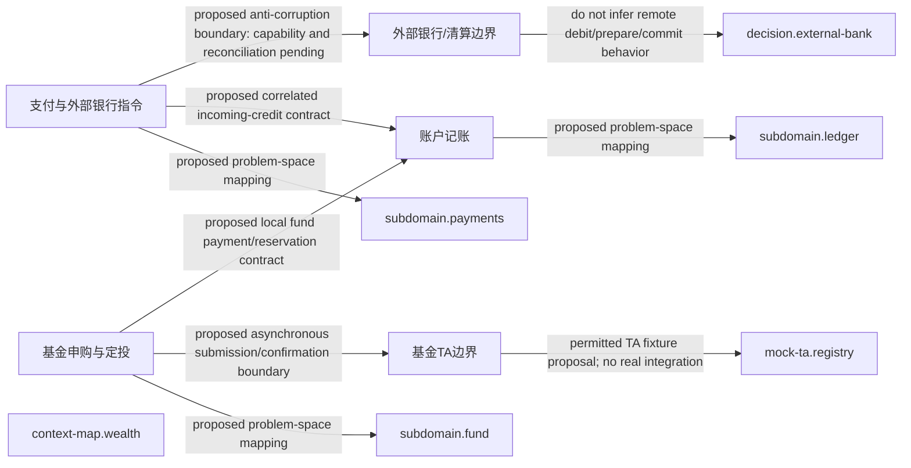

# 候选上下文地图

> 派生设计提议，不是运行结果。修改来源便签，不手改此文件。

## 来源

- `context-map.wealth`：`tree/inbox/contextMapping/relation-cm-wealth-context-map-design-proposal-3.yaml/payload/info/artifact`
- `context.fund`：`tree/inbox/contextMapping/context-cm-wealth-fund-context-design-proposal-2.yaml/payload/info/artifact`
- `context.ledger`：`tree/inbox/contextMapping/context-cm-wealth-ledger-context-design-proposal-0.yaml/payload/info/artifact`
- `context.payments`：`tree/inbox/contextMapping/context-cm-wealth-payments-context-design-proposal-1.yaml/payload/info/artifact`
