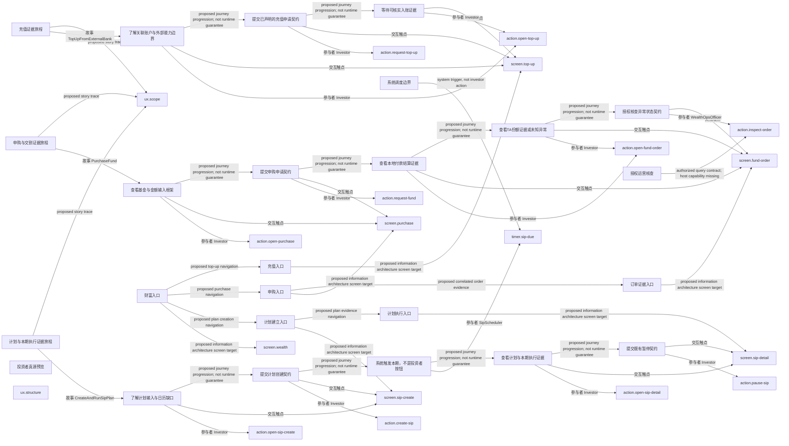

# 用户旅程与信息架构

> 派生设计提议，不是运行结果。修改来源便签，不手改此文件。

## 来源

- `ux.structure`：`tree/inbox/storyMapping/relation-sm-wealth-ux-structure-design-proposal-1.yaml/payload/info/artifact`

## 充值证据旅程 — TopUpFromExternalBank

| 阶段 | 参与者 | 动作 | 触点 | 信息需求 | 实现状态 |
|---|---|---|---|---|---|
| 了解关联账户与外部能力边界 | Investor | action.open-top-up | screen.top-up | 来源/目标账户授权；外部能力未验证说明 | missing |
| 提交已声明的充值申请契约 | Investor | action.request-top-up | screen.top-up | 金额与币种；请求身份与重试说明 | declared |
| 等待可核实入账证据 | Investor | action.open-top-up | screen.top-up | 请求已记录不等于已入账；关联入账查询缺口 | missing |

## 申购与交割证据旅程 — PurchaseFund

| 阶段 | 参与者 | 动作 | 触点 | 信息需求 | 实现状态 |
|---|---|---|---|---|---|
| 查看基金与金额输入框架 | Investor | action.open-purchase | screen.purchase | 基金代码；金额；最低限额/费用/日历未决 | missing |
| 提交申购申请契约 | Investor | action.request-fund | screen.purchase | 安全请求身份；申请已记录文案 | declared |
| 查看本地付款结算证据 | Investor | action.open-fund-order | screen.fund-order | 付款结算事件；不提前显示份额确认 | missing |
| 查看TA份额证据或未知异常 | Investor | action.open-fund-order | screen.fund-order | 确认份额；任意演示净值说明；未知/退款需求区分 | missing |
| 授权核查异常状态契约 | WealthOpsOfficer | action.inspect-order | screen.fund-order | 本地写侧证据；TA查询/退款桥接缺口 | declared |

## 计划与本期执行证据旅程 — CreateAndRunSipPlan

| 阶段 | 参与者 | 动作 | 触点 | 信息需求 | 实现状态 |
|---|---|---|---|---|---|
| 了解计划输入与日历缺口 | Investor | action.open-sip-create | screen.sip-create | 基金/金额/关联账户；cron转换与日历规则未决 | missing |
| 提交计划创建契约 | Investor | action.create-sip | screen.sip-create | 计划身份；计划配置 | declared |
| 系统触发本期，不是投资者按钮 | SipScheduler | timer.sip-due | 系统触点 | 稳定operationId/occurrence；计划与金额一致性 | declared |
| 查看计划与本期执行证据 | Investor | action.open-sip-detail | screen.sip-detail | 本期操作身份；成功/失败终态与计数缺口 | missing |
| 提交既有暂停契约 | Investor | action.pause-sip | screen.sip-detail | 暂停原因；进行中任务处理未决 | declared |
