# 界面与导航设计提议：legacy与cash-v2隔离

> 派生设计提议，不是运行结果。修改来源便签，不手改此文件。

```mermaid
flowchart LR
  n_26582dd5a5a080c7["现金申购确认"]
  n_527efc59ad608e65["现金申购／TA／退款证据"]
  n_949630350a00e464["查看现金申购"]
  n_ba0381aab172195d["提交现金申购"]
  n_ee99b604c1fc2f9a["查看原现金订单"]
  n_899d08ddda8dba97["现金申购与拒绝退款旅程"]
  n_9399f6ea4070563a["选择基金与本金，核对资金路径"]
  n_6a6e7a310f954792["确认并提交唯一现金申购入口"]
  n_20c21afeed91106d["等待实际账户与订单付款证据"]
  n_05f0edb5b072ac20["查看TA受理、确认、拒绝或未知"]
  n_82dc38ed0ed4d2b2["拒绝后跟踪独立退款"]
  n_c77f4a8f16684b7f["申请已记录"]
  n_1ec6c4438e09580e["申请已记录；这不证明扣款、募集账户入账或份额确认。"]
  n_19b4b5c6424782b8["订单付款标记"]
  n_29ca2c9c8af640b7["订单已记录付款标记；完整现金成功仍需关联账户回执与付款结果证据。"]
  n_299d440a969a1a14["现金付款成功证据"]
  n_090f35f4cc76b423["现金付款成功已记录；仍须匹配原交易和三参与者回执，不等于基金份额已确认。"]
  n_653f798b4890317e["付款无效果拒绝"]
  n_a27330960f69f881["现金付款在发生效果前被拒绝；不显示份额确认，也不授权付款后退款。"]
  n_6fde2150d75d3a2c["付款已补偿"]
  n_d60795dc31be4946["现金付款流程已补偿；这不是付款提交后的独立退款成功。"]
  n_5f04990a4864e400["付款待恢复"]
  n_013ed82042fc4cbd["现金付款待恢复；保留原付款身份，核实后才可推进TA，不自动重新扣款。"]
  n_c51e9da7c9aeeeb2["付款结果未知"]
  n_c9d1e7859748566f["现金付款结果未知；等待同一交易核实，不新发付款，不授权退款。"]
  n_a346fbcd57ab6f9d["等待TA结果"]
  n_707b9c5d58f3a2cc["已记录TA提交；请等待受理或最终回执，不要重复付款。"]
  n_0ac52314a50e07fd["TA已受理"]
  n_00ebfc4a0526cc33["TA已受理，不等于份额已确认。"]
  n_ab98736f1226f94c["份额已确认"]
  n_69a2f44902d06b7f["已记录关联TA份额确认；净值和份额是独立演示fixture，不是真实定价。"]
  n_eaec937e19961b2a["TA结果未知"]
  n_aeed7b9b70d73041["TA结果仍待核实；未知不是拒绝，不授权退款或再次扣款。"]
  n_32ab8f48c1e8b55e["TA明确拒绝"]
  n_b3e3b4230f0eefb7["已记录关联TA拒绝；须经原付款证据和授权检查后申请独立退款，这不是已退款。"]
  n_415ed8cf69f0eca7["退款已申请"]
  n_e62307fc24646909["已记录独立退款申请；目标为原投资人账户，金额为原本金，尚不证明到账。"]
  n_45f7dc72b90c3e7a["退款完成证据"]
  n_fd8882cd63847a6c["已记录独立退款成功证据；仅在可信桥核实原交易、退款身份与现金回执后显示。"]
  n_56d8c32d518a4867["退款未启动"]
  n_36cc02c14cd773ba["退款在发生效果前被拒绝；资金未由此证明返还，不自动新发扣款。"]
  n_77be155b02d29622["退款已补偿"]
  n_445def6af1df1aca["本次退款流程已补偿，不等于本金已退回；需要授权核查。"]
  n_0a0183bc909c114c["退款待恢复"]
  n_91fd99f77f5a314b["退款待人工或持久化恢复；保持原退款身份，不创建新退款。"]
  n_668353b00edb76ec["退款结果未知"]
  n_afe73cd32f2897d1["退款结果未知，等待同一退款交易核实；不要显示完成或自动再次扣款。"]
  n_f1f0cd3e5d978bf6["选择基金并确认现金申购"]
  n_b242cb0665579f00["核查TA与退款证据"]
  n_8ecfd1eee7bad71e["ux.cash-v2"]
  n_b67678e238ad1fae["财富总览框架"]
  n_8b0364858c5f5b76["外部充值申请框架"]
  n_d409f3e000251a31["基金申购申请框架"]
  n_27f2ebab1162527e["基金订单进度框架"]
  n_12c56cf7f56d1c57["定投计划建立框架"]
  n_d46f831e6f30be49["定投计划与执行框架"]
  n_38c4122f1033a409["查看充值申请框架"]
  n_76699b574b7560ac["查看申购申请框架"]
  n_74b195e60ee8f8b9["查看定投计划框架"]
  n_74cfe4e46219f93f["提交充值申请"]
  n_503ab97880494330["提交基金申购申请"]
  n_9a225c22a9fccb53["运营核查订单写侧状态"]
  n_bad9fb4c751b6055["建立定投计划"]
  n_41562372b9799d75["暂停定投计划"]
  n_e23ba6490173c5b8["查看申购订单进度"]
  n_e383716561937968["查看定投计划与期次"]
  n_8b5ff3dc003a1be3["ux.skeleton"]
  n_a7437a442b6c219b["充值证据旅程"]
  n_f2fc3d9ccd4f8043["申购与交割证据旅程"]
  n_cc11a4c9b31a3aac["计划与本期执行证据旅程"]
  n_d454aa531f08d224["了解关联账户与外部能力边界"]
  n_ccfc2604c4873ebb["提交已声明的充值申请契约"]
  n_afbf87c341f8da70["等待可核实入账证据"]
  n_7ddf0167ed2bce29["查看基金与金额输入框架"]
  n_b04883c86abda987["提交申购申请契约"]
  n_9fa50c1f777820e7["查看本地付款结算证据"]
  n_71fb154b2b8b93d2["查看TA份额证据或未知异常"]
  n_92899c225603f591["授权核查异常状态契约"]
  n_9c8cd65f113bebf3["了解计划输入与日历缺口"]
  n_d815be42ad1b5c54["提交计划创建契约"]
  n_21541b5921d38215["系统触发本期，不是投资者按钮"]
  n_8b2124ad3129a11b["查看计划与本期执行证据"]
  n_e409f378e317f588["提交既有暂停契约"]
  n_e05cc21a3033962a["财富入口"]
  n_4ce0e2e9901233c5["充值入口"]
  n_b2ae75113ebda94a["申购入口"]
  n_3379fa5a6ee1330c["订单证据入口"]
  n_ba65817b044ae8c4["计划建立入口"]
  n_2a6983ed18acdfae["计划执行入口"]
  n_426becc55da4ad8d["投资者真源预览"]
  n_4321494e05df38b3["授权运营核查"]
  n_3ffa76f70f34874b["系统调度边界"]
  n_d0835fd542d12779["ux.structure"]
  n_82f40deaf09eefc3["ux.surface"]
  n_79964ffd134be20f["ux.scope"]
  n_77252c6540fa6a68["timer.sip-due"]
  n_9399f6ea4070563a -->|"提议体验顺序，非运行保证"| n_6a6e7a310f954792
  n_6a6e7a310f954792 -->|"提议体验顺序，非运行保证"| n_20c21afeed91106d
  n_20c21afeed91106d -->|"提议体验顺序，非运行保证"| n_05f0edb5b072ac20
  n_05f0edb5b072ac20 -->|"仅明确拒绝且付款成功；确认份额不走退款"| n_82dc38ed0ed4d2b2
  n_26582dd5a5a080c7 -->|"唯一新现金请求"| n_ba0381aab172195d
  n_26582dd5a5a080c7 -->|"确认后按原订单身份导航，不重提请求"| n_527efc59ad608e65
  n_c77f4a8f16684b7f -->|"有证据的反馈"| n_1ec6c4438e09580e
  n_19b4b5c6424782b8 -->|"有证据的反馈"| n_29ca2c9c8af640b7
  n_299d440a969a1a14 -->|"有证据的反馈"| n_090f35f4cc76b423
  n_653f798b4890317e -->|"有证据的反馈"| n_a27330960f69f881
  n_6fde2150d75d3a2c -->|"有证据的反馈"| n_d60795dc31be4946
  n_5f04990a4864e400 -->|"有证据的反馈"| n_013ed82042fc4cbd
  n_c51e9da7c9aeeeb2 -->|"有证据的反馈"| n_c9d1e7859748566f
  n_a346fbcd57ab6f9d -->|"有证据的反馈"| n_707b9c5d58f3a2cc
  n_0ac52314a50e07fd -->|"有证据的反馈"| n_00ebfc4a0526cc33
  n_ab98736f1226f94c -->|"有证据的反馈"| n_69a2f44902d06b7f
  n_eaec937e19961b2a -->|"有证据的反馈"| n_aeed7b9b70d73041
  n_32ab8f48c1e8b55e -->|"有证据的反馈"| n_b3e3b4230f0eefb7
  n_415ed8cf69f0eca7 -->|"有证据的反馈"| n_e62307fc24646909
  n_45f7dc72b90c3e7a -->|"有证据的反馈"| n_fd8882cd63847a6c
  n_56d8c32d518a4867 -->|"有证据的反馈"| n_36cc02c14cd773ba
  n_77be155b02d29622 -->|"有证据的反馈"| n_445def6af1df1aca
  n_0a0183bc909c114c -->|"有证据的反馈"| n_91fd99f77f5a314b
  n_668353b00edb76ec -->|"有证据的反馈"| n_afe73cd32f2897d1
  n_b67678e238ad1fae -->|"proposed screen action"| n_38c4122f1033a409
  n_b67678e238ad1fae -->|"proposed screen action"| n_76699b574b7560ac
  n_b67678e238ad1fae -->|"proposed screen action"| n_74b195e60ee8f8b9
  n_8b0364858c5f5b76 -->|"proposed screen action"| n_74cfe4e46219f93f
  n_d409f3e000251a31 -->|"proposed screen action"| n_503ab97880494330
  n_27f2ebab1162527e -->|"proposed screen action"| n_9a225c22a9fccb53
  n_12c56cf7f56d1c57 -->|"proposed screen action"| n_bad9fb4c751b6055
  n_d46f831e6f30be49 -->|"proposed screen action"| n_41562372b9799d75
  n_38c4122f1033a409 -->|"proposed navigation"| n_8b0364858c5f5b76
  n_76699b574b7560ac -->|"proposed navigation"| n_d409f3e000251a31
  n_74b195e60ee8f8b9 -->|"proposed navigation"| n_12c56cf7f56d1c57
  n_b67678e238ad1fae -->|"proposed feedback/accessibility contract"| n_82f40deaf09eefc3
  n_8b0364858c5f5b76 -->|"proposed feedback/accessibility contract"| n_82f40deaf09eefc3
  n_d409f3e000251a31 -->|"proposed feedback/accessibility contract"| n_82f40deaf09eefc3
  n_27f2ebab1162527e -->|"proposed feedback/accessibility contract"| n_82f40deaf09eefc3
  n_12c56cf7f56d1c57 -->|"proposed feedback/accessibility contract"| n_82f40deaf09eefc3
  n_d46f831e6f30be49 -->|"proposed feedback/accessibility contract"| n_82f40deaf09eefc3
  n_b67678e238ad1fae -->|"查看选中业务记录"| n_e23ba6490173c5b8
  n_e23ba6490173c5b8 -->|"携带已授权资源身份"| n_27f2ebab1162527e
  n_b67678e238ad1fae -->|"查看选中业务记录"| n_e383716561937968
  n_e383716561937968 -->|"携带已授权资源身份"| n_d46f831e6f30be49
  n_d454aa531f08d224 -->|"proposed journey progression; not runtime guarantee"| n_ccfc2604c4873ebb
  n_ccfc2604c4873ebb -->|"proposed journey progression; not runtime guarantee"| n_afbf87c341f8da70
  n_7ddf0167ed2bce29 -->|"proposed journey progression; not runtime guarantee"| n_b04883c86abda987
  n_b04883c86abda987 -->|"proposed journey progression; not runtime guarantee"| n_9fa50c1f777820e7
  n_9fa50c1f777820e7 -->|"proposed journey progression; not runtime guarantee"| n_71fb154b2b8b93d2
  n_71fb154b2b8b93d2 -->|"proposed journey progression; not runtime guarantee"| n_92899c225603f591
  n_9c8cd65f113bebf3 -->|"proposed journey progression; not runtime guarantee"| n_d815be42ad1b5c54
  n_d815be42ad1b5c54 -->|"proposed journey progression; not runtime guarantee"| n_21541b5921d38215
  n_21541b5921d38215 -->|"proposed journey progression; not runtime guarantee"| n_8b2124ad3129a11b
  n_8b2124ad3129a11b -->|"proposed journey progression; not runtime guarantee"| n_e409f378e317f588
  n_e05cc21a3033962a -->|"proposed top-up navigation"| n_4ce0e2e9901233c5
  n_e05cc21a3033962a -->|"proposed purchase navigation"| n_b2ae75113ebda94a
  n_b2ae75113ebda94a -->|"proposed correlated order evidence"| n_3379fa5a6ee1330c
  n_e05cc21a3033962a -->|"proposed plan creation navigation"| n_ba65817b044ae8c4
  n_ba65817b044ae8c4 -->|"proposed plan evidence navigation"| n_2a6983ed18acdfae
  n_a7437a442b6c219b -->|"proposed story trace"| n_79964ffd134be20f
  n_f2fc3d9ccd4f8043 -->|"proposed story trace"| n_79964ffd134be20f
  n_cc11a4c9b31a3aac -->|"proposed story trace"| n_79964ffd134be20f
  n_e05cc21a3033962a -->|"proposed information architecture screen target"| n_b67678e238ad1fae
  n_4ce0e2e9901233c5 -->|"proposed information architecture screen target"| n_8b0364858c5f5b76
  n_b2ae75113ebda94a -->|"proposed information architecture screen target"| n_d409f3e000251a31
  n_3379fa5a6ee1330c -->|"proposed information architecture screen target"| n_27f2ebab1162527e
  n_ba65817b044ae8c4 -->|"proposed information architecture screen target"| n_12c56cf7f56d1c57
  n_2a6983ed18acdfae -->|"proposed information architecture screen target"| n_d46f831e6f30be49
  n_3ffa76f70f34874b -->|"system trigger, not investor action"| n_77252c6540fa6a68
  n_4321494e05df38b3 -->|"authorized query contract; host capability missing"| n_9a225c22a9fccb53
  n_899d08ddda8dba97 -->|"故事 CashFundPurchaseLifecycle"| n_9399f6ea4070563a
  n_9399f6ea4070563a -->|"交互触点"| n_26582dd5a5a080c7
  n_9399f6ea4070563a -->|"参与者 Investor"| n_949630350a00e464
  n_6a6e7a310f954792 -->|"交互触点"| n_26582dd5a5a080c7
  n_6a6e7a310f954792 -->|"参与者 Investor"| n_ba0381aab172195d
  n_20c21afeed91106d -->|"交互触点"| n_527efc59ad608e65
  n_20c21afeed91106d -->|"参与者 Investor"| n_ee99b604c1fc2f9a
  n_05f0edb5b072ac20 -->|"交互触点"| n_527efc59ad608e65
  n_05f0edb5b072ac20 -->|"参与者 Investor"| n_ee99b604c1fc2f9a
  n_82dc38ed0ed4d2b2 -->|"交互触点"| n_527efc59ad608e65
  n_82dc38ed0ed4d2b2 -->|"参与者 Investor"| n_ee99b604c1fc2f9a
  n_a7437a442b6c219b -->|"故事 TopUpFromExternalBank"| n_d454aa531f08d224
  n_d454aa531f08d224 -->|"交互触点"| n_8b0364858c5f5b76
  n_d454aa531f08d224 -->|"参与者 Investor"| n_38c4122f1033a409
  n_ccfc2604c4873ebb -->|"交互触点"| n_8b0364858c5f5b76
  n_ccfc2604c4873ebb -->|"参与者 Investor"| n_74cfe4e46219f93f
  n_afbf87c341f8da70 -->|"交互触点"| n_8b0364858c5f5b76
  n_afbf87c341f8da70 -->|"参与者 Investor"| n_38c4122f1033a409
  n_f2fc3d9ccd4f8043 -->|"故事 PurchaseFund"| n_7ddf0167ed2bce29
  n_7ddf0167ed2bce29 -->|"交互触点"| n_d409f3e000251a31
  n_7ddf0167ed2bce29 -->|"参与者 Investor"| n_76699b574b7560ac
  n_b04883c86abda987 -->|"交互触点"| n_d409f3e000251a31
  n_b04883c86abda987 -->|"参与者 Investor"| n_503ab97880494330
  n_9fa50c1f777820e7 -->|"交互触点"| n_27f2ebab1162527e
  n_9fa50c1f777820e7 -->|"参与者 Investor"| n_e23ba6490173c5b8
  n_71fb154b2b8b93d2 -->|"交互触点"| n_27f2ebab1162527e
  n_71fb154b2b8b93d2 -->|"参与者 Investor"| n_e23ba6490173c5b8
  n_92899c225603f591 -->|"交互触点"| n_27f2ebab1162527e
  n_92899c225603f591 -->|"参与者 WealthOpsOfficer"| n_9a225c22a9fccb53
  n_cc11a4c9b31a3aac -->|"故事 CreateAndRunSipPlan"| n_9c8cd65f113bebf3
  n_9c8cd65f113bebf3 -->|"交互触点"| n_12c56cf7f56d1c57
  n_9c8cd65f113bebf3 -->|"参与者 Investor"| n_74b195e60ee8f8b9
  n_d815be42ad1b5c54 -->|"交互触点"| n_12c56cf7f56d1c57
  n_d815be42ad1b5c54 -->|"参与者 Investor"| n_bad9fb4c751b6055
  n_21541b5921d38215 -->|"参与者 SipScheduler"| n_77252c6540fa6a68
  n_8b2124ad3129a11b -->|"交互触点"| n_d46f831e6f30be49
  n_8b2124ad3129a11b -->|"参与者 Investor"| n_e383716561937968
  n_e409f378e317f588 -->|"交互触点"| n_d46f831e6f30be49
  n_e409f378e317f588 -->|"参与者 Investor"| n_41562372b9799d75
```

## 来源

- `ux.cash-v2`：`tree/inbox/storyMapping/relation-sm-cash-purchase-v2-experience-proposal-0.yaml/payload/info/artifact`
- `ux.skeleton`：`tree/inbox/refining/readModel-rf-wealth-ux-skeleton-design-proposal-5.yaml/payload/info/artifact`
- `ux.structure`：`tree/inbox/storyMapping/relation-sm-wealth-ux-structure-design-proposal-1.yaml/payload/info/artifact`
