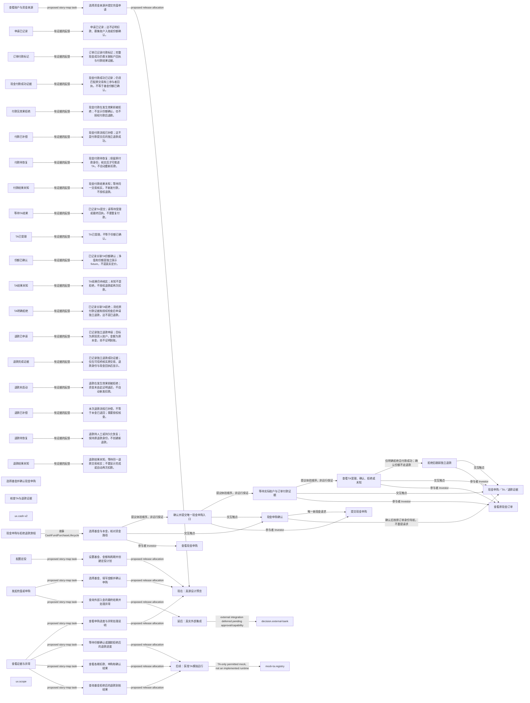

# 用户故事地图：活动、任务与发布切片

> 派生设计提议，不是运行结果。修改来源便签，不手改此文件。

## 来源

- `ux.cash-v2`：`tree/inbox/storyMapping/relation-sm-cash-purchase-v2-experience-proposal-0.yaml/payload/info/artifact`
- `ux.scope`：`tree/inbox/storyMapping/story-sm-wealth-ux-scope-design-proposal-0.yaml/payload/info/artifact`

## 显式故事映射

| 活动 | 任务 | 故事 | 发布切片 |
|---|---|---|---|
| activity.fund | 选择基金并确认现金申购 | CashFundPurchaseLifecycle | release.truth-preview |
| activity.observe | 核查TA与退款证据 | CashFundPurchaseLifecycle | release.mock-runtime |

## 活动主干顺序

1. `activity.fund`
2. `activity.observe`

## 显式故事映射

| 活动 | 任务 | 故事 | 发布切片 |
|---|---|---|---|
| activity.prepare | 选择资金来源并提交充值申请 | TopUpFromExternalBank | release.truth-preview |
| activity.fund | 选择基金、填写金额并确认申购 | PurchaseFund | release.truth-preview |
| activity.plan | 设置基金、金额和周期并创建定投计划 | CreateAndRunSipPlan | release.truth-preview |
| activity.observe | 查看申购进度与异常处理说明 | PurchaseFund | release.truth-preview |
| activity.observe | 等待份额确认或跟踪拒绝后的退款进度 | PurchaseFund | release.mock-runtime |
| activity.observe | 查看各期扣款、申购和确认结果 | CreateAndRunSipPlan | release.mock-runtime |
| activity.fund | 查询外部入金的最终结果并处理异常 | TopUpFromExternalBank | release.external-integration |
| activity.observe | 查询基金拒绝后的退款到账结果 | PurchaseFund | release.mock-runtime |

## 活动主干顺序

1. `activity.prepare`
2. `activity.fund`
3. `activity.plan`
4. `activity.observe`
